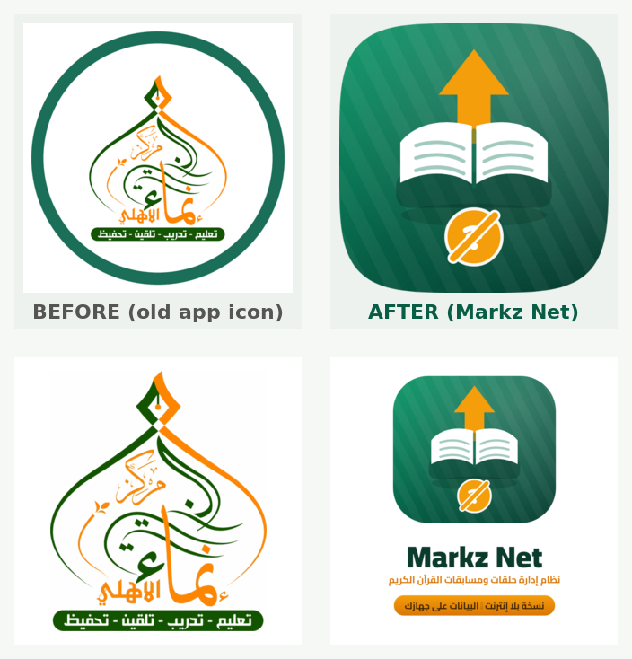

# هوية «Markz Net — نسخة بلا إنترنت» وتمييزها عن التطبيق السابق

> هذا الملف مرجع سريع لكل ما يميّز هذه النسخة عن تطبيق **مركز إنماء الأهلي الخيري**
> (النسخة الأصلية المتصلة بالسحابة)، ويثبت عملياً أنه **لا يستبدلها ولا يمسّ بياناتها**.

## 1) لماذا لا يستبدل التطبيق السابق؟

| العنصر | التطبيق السابق (مركز إنماء) | هذا التطبيق (Markz Net) |
| --- | --- | --- |
| معرّف الحزمة على أندرويد | `org.inmaa.msabkarmdan` | `net.markz.app` |
| الاسم على شاشة الجهاز | مركز إنماء الأهلي الخيري | **Markz Net** |
| الأيقونة | شعار المركز (دائرة خضراء + شعار إنماء) | مصحف + سهم عنبري + شارة «بلا إنترنت» على خلفية خضراء |
| مجلد بيانات التطبيق | `/data/data/org.inmaa.msabkarmdan/` | `/data/data/net.markz.app/` |
| قاعدة بيانات SQLite | `inmaa_local` | `markznet_local` |
| مخزن الوسائط | IndexedDB الخاص بالمتصفح | `markznet_media` |
| مفتاح الجلسة | `msabka.session` | `markznet.session` |
| الكاش (service worker) | لا يوجد | `markz-net-v2-*` |
| محتوى البيانات | بيانات المستخدم السحابية | قاعدة محلية مستقلة تماماً |

**النتيجة:** التطبيقان يُثبَّتان جنباً إلى جنب على الجهاز نفسه، كل واحد باسمه وأيقونته
وقاعدته المستقلة. تثبيت «Markz Net» لا يُلغي التطبيق السابق ولا يحدّثه ولا يقرأ
بياناته، وحذف أحدهما لا يؤثر على الآخر.

> ملاحظة تشغيلية: عند تثبيت تطبيق أندرويد جديد على الجهاز لا يُطلب منك إلغاء أي تطبيق
> آخر — لأن معرّف الحزمة مختلف. يبقى التطبيق السابق كما هو وتُضاف نسخة Markz Net بجانبه.

## 2) صورة المقارنة (قبل / بعد)



أعلى الصورة: أيقونة التطبيق السابق (يمينها اليسار) مقابل الأيقونة الجديدة،
وأسفلها: الشعار القديم مقابل شعار «Markz Net — نسخة بلا إنترنت».

## 2.1) العلامات الظاهرة للمستخدم

1. **الأيقونة:** مصحف مفتوح + سهم عنبري صاعد + شارة «بلا إنترنت» (واي فاي مشطوب)
   — مختلفة كلياً عن شعار المركز.
2. **اسم النظام:** «Markz Net» في الشريط الجانبي وصفحة الدخول، مع وسم
   **«نسخة بلا إنترنت»** في كل ترويسة.
3. **الشارة الخضراء:** «نسخة بلا إنترنت · البيانات على هذا الجهاز» في الشريط الجانبي،
   ورأس صفحة الطلاب ورأس كشف المسابقة ورأس الإعدادات.
4. **بطاقة تعريف:** في صفحة الدخول والإعدادات تحمل شرحاً كاملاً: كل البيانات محلية ولا
   تُرسَل لأي خادم.
5. **الطباعة والتقارير:** كل تقرير مطبوع أو PDF يبدأ بـ
   «Markz Net — نسخة بلا إنترنت · قسم القرآن الكريم» مع الشعار الجديد.
6. **صفحة المتصفح:** اسم الـ PWA وعنوان الصفحة ووصفها وشاشة «تعذّر الوصول» تحمل الاسم
   والوسم الجديدين.
7. **شاشة بداية أندرويد (Splash):** خلفية خضراء متدرجة + الشعار + الوسم
   «نسخة بلا إنترنت · البيانات على هذا الجهاز».

## 3) مصادر الهوية في الشيفرة

| الملف | الدور |
| --- | --- |
| `src/lib/brand.ts` | كل نصوص الهوية (الاسم، الوسم، الترويسات، التوقيع) — لا تكتب الاسم نصّاً في الصفحات |
| `src/components/OfflineBadge.tsx` | الشارة `OfflineBadge` والبطاقة `OfflineNotice` والشريط `OfflineRibbon` |
| `scripts/generate-brand-assets.mjs` | يولّد الأيقونات وشاشات البداية والشعار (`npm run brand:assets`) |
| `scripts/brand-fonts/cairo-*.ttf` | خطوط Cairo المستخدمة في توليد الصور |
| `public/icon-192.png` / `icon-512.png` / `favicon.ico` / `apple-touch-icon.png` | أيقونات الويب |
| `src/assets/logo.png` | الشعار المعروض في الواجهة والطباعة |
| `android/app/src/main/res/mipmap-*/…` | أيقونات أندرويد (عادية + دائرية + تكيفية) |
| `android/app/src/main/res/drawable-*/splash.png` | شاشات بداية أندرويد |
| `android/app/src/main/res/values/strings.xml` | اسم التطبيق على الجهاز |

لإعادة توليد الصور بعد أي تعديل على الشعار:

```bash
npm i -D @napi-rs/canvas   # مرة واحدة
npm run brand:assets       # يكتب الأيقونات والشعارات وشاشات البداية مباشرة
```

## 4) قواعد ثابتة عند التعديل

- لا تُغيّر `appId` (`net.markz.app`) ولا `DB_NAME` (`markznet_local`) ولا مفاتيح
  `localStorage` (`markznet.*`) — تغييرها يعني فقدان بيانات المستخدمين الحاليين.
- لا تعِد استخدام معرّف `org.inmaa.msabkarmdan` أو اسم قاعدة `inmaa_local` إطلاقاً — هما
  للتطبيق السابق.
- أي نص جديد يحمل اسم النظام يجب أن يستورد من `src/lib/brand.ts`.
- لا تضف أي استدعاء شبكي (Supabase أو غيره) — القاعدة الذهبية لهذه النسخة.
